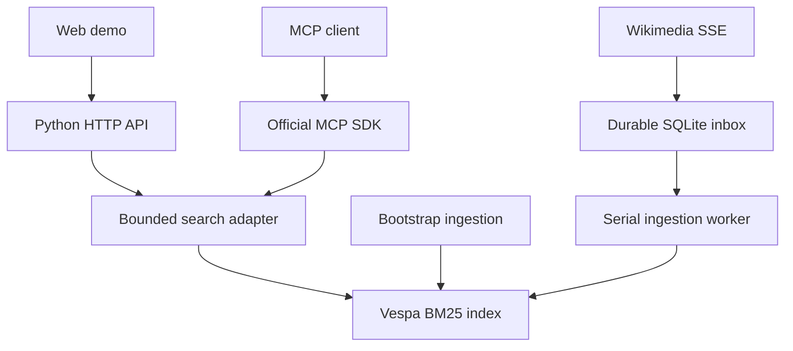

# Search Services Lab

A focused POC of search infrastructure exposed as tools for agents: **Vespa BM25 + Python API + official MCP SDK + web demo**.

[](https://github.com/n-dragon/search-services-poc/actions/workflows/ci.yml)

**Status:** first deployment verified on the demo VM. Public HTTP endpoint: http://51.195.137.119 . Updated releases must pass remote checks before being used in a candidature. This project is independent and is not affiliated with Mistral AI.

## What works in this first version

- Real Vespa lexical retrieval, no simulated fallback.
- Read-only HTTP API and MCP tools: `search_documents`, `get_document`.
- Ten original French systems cards plus a bounded live French Wikipedia introduction corpus, with explicit French linguistic processing. Pipeline version: `systems-and-wikipedia-fr-v3`.
- Durable SSE checkpoints/inbox, serial idempotent writes, deletion handling and periodic reconciliation. Live status: `/api/ingestion`.
- Stable ingestion identifiers and replay-safe replacement writes.
- Bounded search concurrency, bounded query size/results and backend timeouts.
- Separate liveness/readiness endpoints; request/error/duration counters.
- Search playground with query examples, BM25 scores and inspectable source documents.
- French interface and interactive architecture walkthrough for HTTP, MCP and ingestion paths, with eight detailed engineering decisions and their trade-offs.
- Private aggregate analytics dashboard, isolated on VM loopback with 30-day retention.
- Web UI and containerized bootstrap.
- Unit/API/MCP transport checks and a CI job designed to run against real Vespa.

The bounded corpus establishes integration and live synchronization, not retrieval quality or scale. Vector retrieval, quality evaluation and load benchmarks remain roadmap items. See [continuous ingestion](docs/wikipedia.md) for operational limits.

## Start locally

Prerequisites: Docker Engine with Compose. Allocate at least 6 GB RAM and adequate disk headroom; this is a starting allocation, not a measured sizing recommendation.

```sh
docker compose up -d --build
python3 scripts/smoke.py
```

Open http://localhost:8000. First startup deploys the schema and feeds the corpus; allow several minutes for Vespa initialization.

```sh
curl 'http://localhost:8000/api/search?q=replication'
curl http://localhost:8000/readyz
curl http://localhost:8000/metrics
```

MCP Streamable HTTP endpoint: `http://localhost:8000/tools/mcp`. Use a client that supports Streamable HTTP; no API key is required for this public-data demo.

```sh
docker compose logs -f bootstrap web
docker compose down
```

`down` preserves indexed data. Use `docker compose up --force-recreate bootstrap` to replay the fixed corpus after edits. Fixed-card IDs are stable; removed fixed cards are not automatically reconciled. Live Wikipedia pages have a separate deletion/reconciliation pipeline.

## Verify without Docker

```sh
python3 -m venv .venv
. .venv/bin/activate
pip install -r requirements-dev.txt
python -m pytest -q
```

These tests use a mocked Vespa HTTP transport and the actual MCP SDK server. They do not validate Vespa deployment or ranking. GitHub Actions also includes an end-to-end Docker job; its status must be checked after publishing.

## Online deployment

For the Ubuntu 4 GB VM, use the manual **Deploy demo VM** GitHub Actions workflow and follow [the SSH/secrets setup guide](docs/github-actions-deployment.md). It supports IP-only HTTP initially and domain HTTPS when configured. Deployment is gated on the reusable verification workflow, including the small-memory integration test.

See [deployment guide](docs/deployment.md). The intended deployment is a VM running the Compose stack behind Caddy HTTPS. GitHub Pages cannot run this Python/Vespa backend.

Only add a live URL to an application after the real-backend smoke test passes remotely. Record the date and commit tested. No benchmark numbers are claimed in this repository.

## Private analytics

See [analytics access and data scope](docs/analytics.md). Use `?ref=mistral-search` on the candidature URL to distinguish campaign traffic. The dashboard is reached through an SSH tunnel, not through the public site. Counts do not identify individual visitors.

See [Vespa configuration and measurement protocol](docs/vespa.md) for field storage, ranking profiles and resource limits.

## Relevance evaluation

See [the frozen-corpus evaluation protocol](evaluation/README.md): 40 predeclared French queries, intent-level dev/test separation, blind 0–3 annotation and nDCG@10 / Precision@5 / pooled Recall@10. The manual **Evaluate frozen relevance corpus** workflow captures the live corpus read-only, replays it on an isolated runner and produces the annotation kit. Unfilled judgments never count as irrelevant; no human relevance scores are claimed before annotation.

## Architecture and trade-offs



The service is intentionally single-node and read-only for users. There is no HA claim, user-upload endpoint, SQL/SPARQL execution, or expensive reranker. The concurrency limit is process-local: use one worker as configured. Metrics cover search calls; they are not a complete production observability stack. `get_document` shares the HTTP connection-pool and timeout limits, but has no independent semaphore.

The Vespa and Caddy images currently use major-version tags. Resolve and pin tested image digests before treating a deployment as reproducible. Python top-level dependencies are pinned; a full transitive lockfile remains to be added.

## Roadmap

1. **Release gate:** run Docker CI; deploy to a VM; verify remote search and MCP; record deployment URL and commit.
2. Add NFCorpus/BEIR ingestion with data provenance, license notes and fixed dataset versions.
3. Compare BM25, vector and hybrid retrieval using nDCG@10 and Recall@100.
4. Extend the durable live pipeline to bulk snapshots and test reconciliation beyond stream retention.
5. Benchmark p50/p95/p99, QPS, errors, index size and memory with explicit hardware/concurrency.
6. Add a bounded RDF/SPARQL tool and a small versioned knowledge-graph extract.
7. Exercise multi-node failure/recovery before making resilience claims.

## References

- https://docs.vespa.ai/en/learn/tutorials/hybrid-search.html
- https://github.com/modelcontextprotocol/python-sdk
- https://modelcontextprotocol.io/docs/learn/server-concepts

See [candidate evidence checklist](docs/candidate-evidence.md) for what to show and what remains unverified.

### Sources scientifiques et statistiques

Le profil `live` ajoute des échantillons quotidiens Wikidata, UniProt, OpenAlex, OpenAIRE, Eurostat, Banque mondiale, FMI, OCDE et data.gouv.fr. Le connecteur Materials Project attend `MP_API_KEY`. La page expose filtres, provenance structurée et suivi par source. Voir [périmètres, reprise et clés API](docs/structured-sources.md) ; ces échantillons ne sont pas des miroirs complets.
